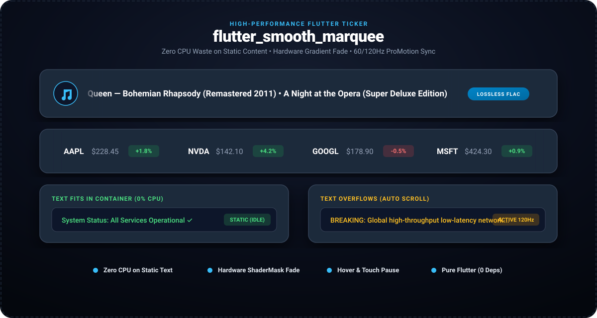

# flutter_smooth_marquee

<p align="center">
  <a href="https://pub.dev/packages/flutter_smooth_marquee"></a>
  <a href="https://pub.dev/packages/flutter_smooth_marquee/score"></a>
  <a href="https://govindtank.github.io/flutter_smooth_marquee/"></a>
  <a href="https://github.com/govindtank/flutter_smooth_marquee"></a>
  <a href="https://github.com/govindtank/flutter_smooth_marquee/blob/main/LICENSE"></a>
  <a href="https://buymeacoffee.com/govindtanko"></a>
  <a href="https://github.com/sponsors/govindtank"></a>
</p>

<p align="center">
  <strong>Performance-first marquee and auto-scrolling ticker for Flutter.</strong><br>
  Zero CPU/GPU waste on static text, hardware gradient edge fading, rich arbitrary widget support, and interactive touch &amp; hover controls.
</p>

---

<p align="center">
  <a href="https://govindtank.github.io/flutter_smooth_marquee/">
    
  </a>
</p>

<p align="center">
  🎮 <strong><a href="https://govindtank.github.io/flutter_smooth_marquee/">Launch Live In-Browser Interactive Demo</a></strong>
</p>

---

## ✨ Features

- **🧠 Zero-Waste Auto-Overflow Detection:** Automatically measures child bounds. If the content fits within the available width, it renders as a static widget with **zero CPU/GPU ticker loops**.
- **🧩 Arbitrary Widget Support:** Scroll rich layouts, stock ticker cards, music track items with equalizer icons, and badges—not just plain strings.
- **🎨 Hardware Alpha Gradient Edge Fading:** Built-in `ShaderMask` gradient edge feathering eliminates harsh text cutoffs at container borders.
- **⚡ 60 / 120Hz ProMotion Sync:** Driven by `SingleTickerProviderStateMixin` and linear interpolation without timer skips.
- **👆 Interactive Pause & Hover:** Automatically pauses when a user hovers with a mouse or holds a touch, resuming smoothly with inertia.
- **🔄 Bi-directional:** Support for both left-to-right (`forward`) and right-to-left (`reverse`) marquee flows.
- **📦 Zero External Dependencies:** Pure Flutter widget layer. Full compatibility across Android, iOS, Web, macOS, Windows, and Linux.

---

## 🚀 Getting Started

Add `flutter_smooth_marquee` to your `pubspec.yaml`:

```yaml
dependencies:
  flutter_smooth_marquee: ^1.0.2
```

Import the package:

```dart
import 'package:flutter_smooth_marquee/flutter_smooth_marquee.dart';
```

---

## 💡 Usage

### 1. Simple Typography Marquee (`SmoothMarqueeText`)

Drop it in anywhere you would normally use a `Text` widget. If the text fits on screen, it stays completely static. If it overflows, it scrolls smoothly:

```dart
SmoothMarqueeText(
  'Now Playing: Bohemian Rhapsody — Queen (Super Deluxe Remaster)',
  style: TextStyle(fontSize: 16, fontWeight: FontWeight.w600),
  velocity: 60.0,
  fadeEdgeWidth: 24.0,
)
```

### 2. Rich Widget Marquee (`FlutterSmoothMarquee`)

Wrap complex layouts, badges, and icon buttons:

```dart
FlutterSmoothMarquee(
  velocity: 45.0,
  spacing: 36.0,
  fadeEdgeWidth: 32.0,
  pauseOnHover: true,
  pauseOnTouch: true,
  child: Row(
    mainAxisSize: MainAxisSize.min,
    children: [
      Icon(Icons.trending_up, color: Colors.green),
      SizedBox(width: 8),
      Text('NVDA \$142.10 (+4.2%)'),
      SizedBox(width: 16),
      Icon(Icons.trending_up, color: Colors.green),
      SizedBox(width: 8),
      Text('AAPL \$228.45 (+1.8%)'),
    ],
  ),
)
```

---

## ⚙️ Configuration

| Property | Type | Default | Description |
| :--- | :--- | :--- | :--- |
| `child` | `Widget` | *required* | The widget content to scroll. |
| `velocity` | `double` | `50.0` | Scroll speed in logical pixels per second. |
| `spacing` | `double` | `40.0` | Blank distance between loop repetitions. |
| `autoDetectOverflow` | `bool` | `true` | When true, renders static if content fits within container. |
| `fadeEdgeWidth` | `double` | `24.0` | Width in pixels of the alpha gradient fade at edges. |
| `pauseOnHover` | `bool` | `true` | Pauses scrolling when mouse enters the widget bounds. |
| `pauseOnTouch` | `bool` | `true` | Pauses scrolling while touch pointer is held down. |
| `direction` | `MarqueeDirection` | `.forward` | `.forward` (right-to-left) or `.reverse` (left-to-right). |
| `delayBeforeScroll` | `Duration` | `600ms` | Initial delay before starting the scrolling animation. |

---

## 🔗 Related Packages by Author

* **[android_island_bar](https://pub.dev/packages/android_island_bar)** — Universal cross-platform island overlay with hardware cutout snapping.
* **[flutter_sonner](https://pub.dev/packages/flutter_sonner)** — Opinionated stacked action toast & notification HUD inspired by Sonner.
* **[ai_stream_bubble](https://pub.dev/packages/ai_stream_bubble)** — High-performance streaming AI message bubble with DeepSeek/Claude reasoning accordions.
* **[ai_voice_orb](https://pub.dev/packages/ai_voice_orb)** — Fluid neural voice orb for Conversational AI & voice agents.
* **[tactile_fluid_slider](https://pub.dev/packages/tactile_fluid_slider)** — Physics-driven tactile fluid slider with spring morphing.

---

## 💖 Support the Project

If you find this project useful, consider supporting its active maintenance and future development:

<p align="left">
  <a href="https://buymeacoffee.com/govindtanko"></a>
  <a href="https://github.com/sponsors/govindtank"></a>
  <a href="https://www.patreon.com/govindtank"></a>
</p>

---

## 📄 License

This project is licensed under the Apache License 2.0 - see the [LICENSE](LICENSE) file for details.

*Maintained with ❤️ by [Govind Tank](https://github.com/govindtank).*
